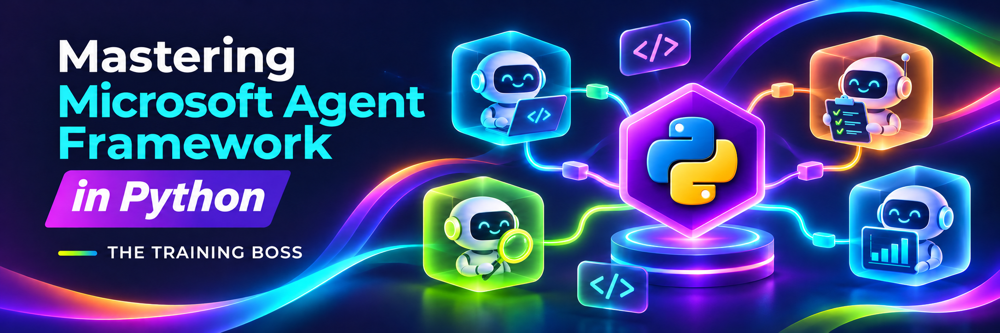

# Mastering Microsoft Agent Framework in Python

Welcome to **Mastering Microsoft Agent Framework in Python**, a hands-on course exploring how to build AI agents with [Microsoft Agent Framework](https://learn.microsoft.com/agent-framework/) (MAF).

This repo is intended to accompany the full online video course with full demonstrations on the [Training Boss website](https://thetrainingboss.com/course/microsoft-agent-framework-fundamentals-in-python/) 

The 45 labs build on each other: you start by connecting to a model, then add tools, RAG, multimodal content, persistent history, AG-UI, observability, workflows, and agent skills. Most are standalone Python scripts; the AG-UI client and server labs are designed to run together.

---

## What you will learn

By the end of the course you will be able to:

- **Connect agents to any model provider:** OpenAI, Azure OpenAI, Anthropic, Google Gemini, xAI Grok, Mistral, and Microsoft Foundry, all through one `Agent` abstraction.
- **Run models locally** with Ollama and Foundry Local (CPU, GPU, or NPU), with no cloud account required.
- **Stream responses** token by token and build interactive console chat experiences.
- **Track token usage**, including input, output, and reasoning tokens.
- **Shape agent behavior** with instructions, personas, and default options such as `max_tokens` and reasoning effort.
- **Give agents tools** with Python function calling (`@tool`), hosted tools such as Code Interpreter and Web Search, and remote tools through the **Model Context Protocol (MCP)**.
- **Download files** that the Code Interpreter generates, such as charts.
- **Intercept and control execution** with function middleware for logging, auditing, and guardrails.
- **Compose agents** by exposing one agent as a tool of another (agent-as-a-tool).
- **Get typed, structured output** from an agent with Pydantic models and `response_format`.
- **Generate embeddings** and measure semantic similarity with cosine similarity.
- **Store and search vectors** in Azure AI Search with `AzureAISearchStore` and `@vectorstoremodel`.
- **Build Retrieval-Augmented Generation (RAG)**, first by injecting search results into the prompt, then agentically by giving the agent a search tool.
- **Work with multimodal content:** send images and PDFs to a model, and generate images with the hosted image generation tool.
- **Enrich every run** with a custom `ContextProvider` that injects instructions and tools before the LLM call and processes the result after it.
- **Persist and compact conversation history** with Azure Cosmos DB, and explore a vector-based semantic cache.
- **Connect an AG-UI client and server**, including server and client tools, and explore agents and workflows in DevUI.
- **Trace agent runs** with OpenTelemetry, console output, and optional Azure Application Insights export.
- **Build workflows** with custom executors, sequential and concurrent agents, handoffs, and round-robin group chat.
- **Pause and resume workflows for human input** in an interactive animal-guessing game.
- **Load agent skills** and handle skill-tool approval requests.
- **Use GitHub Copilot** as an agent and explore Azure OpenAI model routing.
- **Generate images and video with Google models** and save the results locally.

---

## Lab catalog

| #  | Lab | What it covers | Provider / requirement |
|----|-----|----------------|------------------------|
| 01 | [01-OpenAIDemo.py](./src/01-OpenAIDemo.py) | Your first agent with `OpenAIChatClient` | OpenAI API key |
| 02 | [02-AzureOpenAIDemo.py](./src/02-AzureOpenAIDemo.py) | The same agent on Azure OpenAI | Azure OpenAI resource |
| 03 | [03-AnthropicDemo.py](./src/03-AnthropicDemo.py) | Using Claude with `AnthropicClient` | Anthropic API key |
| 04 | [04-GoogleDemo.py](./src/04-GoogleDemo.py) | Gemini through its OpenAI-compatible endpoint | Google AI Studio key |
| 05 | [05-GrokDemo.py](./src/05-GrokDemo.py) | xAI Grok through a custom `base_url` | xAI API key |
| 06 | [06-MistralDemo.py](./src/06-MistralDemo.py) | Mistral through `OpenAIChatCompletionClient` | Mistral API key |
| 07 | [07-FoundryDemo.py](./src/07-FoundryDemo.py) | Microsoft Foundry with Entra ID auth (`AzureCliCredential`) | Foundry project + `az login` |
| 08 | [08-OllamaDemo.py](./src/08-OllamaDemo.py) | Local models with `OllamaChatClient` | Ollama running locally |
| 09 | [09-FoundryLocalDemo.py](./src/09-FoundryLocalDemo.py) | On-device models with Foundry Local (NPU > GPU > CPU) | `foundry-local-sdk` |
| 10 | [10-StreamingDemo.py](./src/10-StreamingDemo.py) | Streaming responses with `stream=True` | Azure OpenAI |
| 11 | [11-ChatDemo.py](./src/11-ChatDemo.py) | Interactive chat loop and token usage | Azure OpenAI |
| 12 | [12-SimpleAgentDemo.py](./src/12-SimpleAgentDemo.py) | Personas, `default_options`, reasoning effort | Azure OpenAI |
| 13 | [13-FunctionCallDemo.py](./src/13-FunctionCallDemo.py) | Function calling with `@tool` and typed parameters | Azure OpenAI |
| 14 | [14-CodeInterpreter.py](./src/14-CodeInterpreter.py) | Hosted Code Interpreter and downloading generated files | Azure OpenAI (Responses API) |
| 15 | [15-WebSearchTool.py](./src/15-WebSearchTool.py) | Hosted Web Search tool combined with a local tool | Azure OpenAI (Responses API) |
| 16 | [16-MCPTool.py](./src/16-MCPTool.py) | Remote MCP server (Microsoft Learn) with `MCPStreamableHTTPTool` | Azure OpenAI + internet |
| 17 | [17-AgentMiddleware.py](./src/17-AgentMiddleware.py) | Function middleware and agent-as-a-tool | Azure OpenAI (Responses API) |
| 18 | [18-StructuredOutput.py](./src/18-StructuredOutput.py) | Structured output with Pydantic models and `response_format` | Azure OpenAI (`gpt-5`, `gpt-5-mini`) |
| 19 | [19-EmbeddingDemo.py](./src/19-EmbeddingDemo.py) | Embeddings with `OpenAIEmbeddingClient` and cosine similarity | Azure OpenAI (`text-embedding-3-small`) |
| 20 | [20-VectorStoreDemo.py](./src/20-VectorStoreDemo.py) | Loading a knowledge base into a vector store with `AzureAISearchStore` | Azure OpenAI + Azure AI Search |
| 21 | [21-SemanticSearchDemo.py](./src/21-SemanticSearchDemo.py) | Semantic search, then answering with the results in the prompt (RAG) | Azure OpenAI + Azure AI Search |
| 22 | [22-AgenticRAGDemo.py](./src/22-AgenticRAGDemo.py) | Agentic RAG: the agent calls a vector search tool | Azure OpenAI + Azure AI Search |
| 23 | [23-ReasoningEffortDemo.py](./src/23-ReasoningEffortDemo.py) | Comparing reasoning effort levels and their token usage | Azure OpenAI |
| 24 | [24-ModelImageDemo.py](./src/24-ModelImageDemo.py) | Sending an image to a model for analysis (base64 data URI or URL) | Azure OpenAI |
| 25 | [25-ImageGeneration-OpenAI.py](./src/25-ImageGeneration-OpenAI.py) | Hosted image generation tool, saving the generated image | OpenAI API key (`gpt-image-2`) |
| 26 | [26-ImageGeneration-AzureOpenAI.py](./src/26-ImageGeneration-AzureOpenAI.py) | Hosted image generation on Azure OpenAI | Azure OpenAI + image generation deployment |
| 27 | [27-ModelPDFDemo.py](./src/27-ModelPDFDemo.py) | Asking questions about a PDF document | OpenAI API key + sample PDF |
| 28 | [28-AIContextProviderDemo.py](./src/28-AIContextProviderDemo.py) | Custom `ContextProvider` with `before_run` and `after_run` hooks | Azure OpenAI |
| 29 | [29-CosmosDBChatHistory.py](./src/29-CosmosDBChatHistory.py) | Persistent conversation history and summarization-based compaction | Azure OpenAI + Azure Cosmos DB |
| 30 | [30-SemanticCacheDemo.py](./src/30-SemanticCacheDemo.py) | Semantic cache using embeddings and Cosmos DB vector search | Azure OpenAI + Azure Cosmos DB vector search |
| 31 | [31-AGUIServerDemo.py](./src/31-AGUIServerDemo.py) | Serve an agent and weather tool over AG-UI | Azure OpenAI + FastAPI |
| 32 | [32-AGUIClientDemo.py](./src/32-AGUIClientDemo.py) | Streaming AG-UI client with a client-side console color tool | Lab 31 server running locally |
| 33 | [33-DevUIDemo.py](./src/33-DevUIDemo.py) | Explore agents and sequential and concurrent workflows in DevUI | Azure OpenAI + browser |
| 34 | [34-OpenTelemetryDemo.py](./src/34-OpenTelemetryDemo.py) | Trace agent runs to the console and optionally Azure Monitor | Azure OpenAI; Application Insights optional |
| 35 | [35-WorkflowWithoutAI.py](./src/35-WorkflowWithoutAI.py) | Connect custom executors to uppercase and reverse text | No model provider required |
| 36 | [36-SequentialWorkflowDemo.py](./src/36-SequentialWorkflowDemo.py) | Sequential agents summarize text and translate the summary into French | Azure OpenAI (`gpt-5`) |
| 37 | [37-ConcurrentWorkflowDemo.py](./src/37-ConcurrentWorkflowDemo.py) | Concurrent agents review legal text and spelling | Azure OpenAI (`gpt-5`) |
| 38 | [38-HandoffWorkflowDemo.py](./src/38-HandoffWorkflowDemo.py) | Supervisor hands questions to movie or music specialists | Azure OpenAI (`gpt-5`, `gpt-5-mini`) |
| 39 | [39-GroupChatWorkflowDemo.py](./src/39-GroupChatWorkflowDemo.py) | Movie and music agents take turns in a round-robin group chat | Azure OpenAI (`gpt-5`) |
| 40 | [40-HumanInTheLoopWorkflowDemo.py](./src/40-HumanInTheLoopWorkflowDemo.py) | Pause and resume an animal-guessing workflow for user input | Azure OpenAI (`gpt-5`) |
| 41 | [41-AgentSkillsDemo.py](./src/41-AgentSkillsDemo.py) | Load local skills with `SkillsProvider` and approve skill-tool requests | Azure OpenAI (`gpt-5`) + local skills |
| 42 | [42-GitHubCopilotDemo.py](./src/42-GitHubCopilotDemo.py) | Run a GitHub Copilot agent with a weather tool and usage reporting | GitHub Copilot access + Copilot CLI |
| 43 | [43-ModelRouterDemo.py](./src/43-ModelRouterDemo.py) | Use Azure OpenAI model routing and report the selected model | Azure OpenAI `model-router` deployment |
| 44 | [44-NanoBananaDemo.py](./src/44-NanoBananaDemo.py) | Generate and save images with a Gemini image model | Google API key + `gemini-3.1-flash-image` access |
| 45 | [45-GoogleVideoDemo.py](./src/45-GoogleVideoDemo.py) | Request and save video from the Google Interactions API | Google API key + `gemini-omni-1.2-flash` access |

---

## Prerequisites

- **Python 3.11 or later.** Python 3.12+ is recommended.
- **Git.**
- **An editor.** [Visual Studio Code](https://code.visualstudio.com/) with the Python extension is recommended.
- **At least one model provider.** You don't need every provider. Most labs from 10 onward use **Azure OpenAI**, so that's the best one to set up first.
  - [OpenAI](https://platform.openai.com/api-keys) API key
  - [Azure OpenAI](https://learn.microsoft.com/azure/ai-services/openai/) resource with a deployed model (for example `gpt-5`)
  - [Anthropic](https://console.anthropic.com/) API key
  - [Google AI Studio](https://aistudio.google.com/apikey) API key
  - [xAI](https://console.x.ai/) API key
  - [Mistral](https://console.mistral.ai/) API key
  - [Microsoft Foundry](https://ai.azure.com/) project and the [Azure CLI](https://learn.microsoft.com/cli/azure/install-azure-cli)
- **For embeddings (19–22, 30):** a `text-embedding-3-small` deployment in Azure OpenAI. Labs 20–22 also require an [Azure AI Search](https://learn.microsoft.com/azure/search/) service.
- **For the Azure image generation lab (26):** an image generation model deployment (for example `gpt-image-2.5-flare`) in Azure OpenAI.
- **For labs 29 and 30:** an Azure Cosmos DB for NoSQL account. Lab 30 also needs a database and a vector-enabled container.
- **For lab 34 (optional):** an Application Insights resource and its connection string for Azure Monitor export.
- **For lab 42:** the GitHub Copilot CLI, an authenticated account with Copilot access, and access to the configured model.
- **For labs 43–45:** access to the model router deployment or Google models named in the scripts. Availability can vary by account and region.
- **For the local labs (optional):**
  - [Ollama](https://ollama.com/download) with a pulled model (`ollama pull gemma4`)
  - [Foundry Local](https://learn.microsoft.com/azure/ai-foundry/foundry-local/)

Cloud model calls and Azure resources may incur charges, including image and video generation. Check provider pricing and clean up resources you no longer need.

---

## Getting started

### 1. Clone the repository

```bash
git clone https://github.com/TheTrainingBoss/MAF-Python.git
cd MAF-Python
```

### 2. Create and activate a virtual environment

**Windows (PowerShell)**

```powershell
python -m venv .venv
.\.venv\Scripts\Activate.ps1
```

**macOS / Linux**

```bash
python3 -m venv .venv
source .venv/bin/activate
```

> In VS Code, you can also run **Python: Create Environment** from the Command Palette and select `requirements.txt`.

### 3. Install dependencies

```bash
pip install --upgrade pip
pip install -r requirements.txt
```

The requirements include the Foundry Local SDK and the packages used by the Cosmos DB, AG-UI, DevUI, OpenTelemetry, GitHub Copilot, and Gemini labs.

### 4. Configure your environment variables

Copy the template, then fill in the keys for the providers you plan to use:

```powershell
# Windows
Copy-Item .env.example .env
```

```bash
# macOS / Linux
cp .env.example .env
```

| Variable | Used by |
|----------|---------|
| `OPENAI_API_KEY` | Labs 01, 25, 27 |
| `OPENAI_MODEL` | Lab 01 |
| `AZURE_OPENAI_API_KEY`, `AZURE_OPENAI_ENDPOINT` | Labs 02, 10–24, 26, 28–31, 33, 34, 36–41, 43 |
| `AZURE_OPENAI_MODEL` | Lab 02 and other labs that read the model from the environment |
| `AZURE_SEARCH_ENDPOINT`, `AZURE_SEARCH_API_KEY`, `AZURE_SEARCH_INDEX_NAME` | Labs 21, 22 |
| `COSMOS_ENDPOINT`, `COSMOS_API_KEY` | Labs 29, 30 |
| `COSMOS_DATABASE_NAME`, `COSMOS_CACHE_CONTAINER_NAME` | Lab 30 |
| `APPLICATION_INSIGHTS_INSTRUMENTATION_KEY` | Lab 34: full Application Insights **connection string**, or empty for console-only tracing |
| `ANTHROPIC_API_KEY`, `ANTHROPIC_MODEL` | Lab 03 |
| `GOOGLE_API_KEY` | Labs 04, 44, 45 |
| `GOOGLE_MODEL` | Lab 04 |
| `GROK4_API_KEY`, `GROK4_MODEL`, `GROK4_BASE_URL` | Lab 05 |
| `MISTRAL_API_KEY`, `MISTRAL_MODEL` | Lab 06 |
| `FOUNDRY_PROJECT_ENDPOINT`, `FOUNDRY_MODEL` | Lab 07 |

> ⚠️ **Never commit your `.env` file.** It's already listed in `.gitignore`. Only `.env.example` is tracked.

Some labs from 18 onward use deployment names directly in the code (for example `gpt-5`, `gpt-5-mini`, `text-embedding-3-small`, and `gpt-image-2.5-flare`). If your Azure OpenAI deployments have different names, update the `model=` values in the script.

Lab 20 has placeholders for the Azure AI Search endpoint, key, and index name. Replace them before you run it, and use the same index name as `AZURE_SEARCH_INDEX_NAME` so labs 21 and 22 can search the data that lab 20 loads.

Add `COSMOS_CACHE_CONTAINER_NAME` to `.env` for lab 30. Lab 29 uses the hard-coded database `ttbcosmosdb` and container `chathistory-python`, rather than the database and container variables in `.env.example`. For lab 30, configure the existing container for vector search on `embedding` with partition key `/pk`.

For lab 34, `APPLICATION_INSIGHTS_INSTRUMENTATION_KEY` must contain the full Application Insights connection string, not just an instrumentation key. Leave it empty for console-only tracing; leaving it unset causes the current script to fail.

Lab 42 uses the logged-in Copilot user by default; `GITHUB_TOKEN` in `.env.example` is only used if you uncomment the token-based client configuration. Lab 43 uses a deployment named `model-router`; change the name in the script if yours differs. Labs 44 and 45 use model names in the scripts, not `GOOGLE_MODEL`.

For lab 07 (Microsoft Foundry), sign in to Azure so `AzureCliCredential` can get a token:

```bash
az login
```

### 5. Run a lab

Run a lab from the repository root with your virtual environment active:

```bash
python src/01-OpenAIDemo.py
```

To exit the interactive labs (11, 12, and 13), type `exit` or `quit`. Labs 21, 22, 32, 38, and 39 keep asking questions in a loop; press `Ctrl+C` to stop them. Lab 40 prompts for animal guesses until you guess correctly.

Run the RAG labs in order: lab 20 loads the knowledge base into Azure AI Search (press `Y` when asked to import data), and labs 21 and 22 search it. **Importing deletes and recreates the selected index**, so use a dedicated lab index.

For AG-UI, start lab 31 first, then run lab 32 in a second terminal:

```bash
python src/31-AGUIServerDemo.py
python src/32-AGUIClientDemo.py
```

Lab 31 listens on `localhost:5000` and declares a single-user scope; this does not authenticate callers. Lab 33 opens DevUI at `127.0.0.1:5266` with authentication disabled for local development. Do not expose these demo configurations as shared services.

Lab 34 enables sensitive telemetry, which can include prompts and responses. Use only non-sensitive test data and protect any exported traces.

Lab 41 looks for `AgentSkills` in the current working directory. Run it from `src`, then return to the repository root:

```bash
cd src
python 41-AgentSkillsDemo.py
cd ..
```

Labs 41 and 42 automatically approve their respective skill-tool or Copilot permission requests. They are demonstrations, not approval policies for shared or production environments.

Labs 44 and 45 save generated media under `src/media`. Both use fixed output filenames and can overwrite previous outputs with the same names.

---

## Repository structure

```text
MAF-Python/
├── src/
│   ├── 01-OpenAIDemo.py … 45-GoogleVideoDemo.py  # Labs, numbered in learning order
│   ├── AgentSkills/                                # Skills used by lab 41
│   └── media/                                      # Created for lab media and generated images
├── media/                                          # Course image and sample PDF
├── .env.example                                    # Environment variable template (copy to .env)
├── requirements.txt                                # Pinned Python dependencies
└── README.md
```

Labs follow the naming convention `NN-ShortDescription.py`. To get the most out of the course, work through them in order.

---

## Troubleshooting

| Problem | Fix |
|---------|-----|
| `ModuleNotFoundError: agent_framework` | Activate the virtual environment, then run `pip install -r requirements.txt`. |
| `401 Unauthorized` / invalid API key | Check the matching key in `.env`. Make sure the value has no quotes or trailing spaces. |
| Azure OpenAI `DeploymentNotFound` | `AZURE_OPENAI_MODEL` must match your **deployment name**, not just the model name. |
| Lab 07 credential error | Run `az login` and make sure your account has access to the Foundry project. |
| Lab 08 connection refused | Start Ollama and pull the model: `ollama pull gemma4`. |
| Hosted tools (labs 14, 15, and 17) fail | Use a model and region that support the Responses API with Code Interpreter or Web Search. |
| Labs 18–43 `DeploymentNotFound` | If the deployment name is set in the script (for example `gpt-5` or `model-router`), change `model=` to match your deployment. |
| Labs 21 and 22 return no results | Run lab 20 first and import the data into the same index named in `AZURE_SEARCH_INDEX_NAME`. |
| Labs 20 or 21 `ModuleNotFoundError: msvcrt` | Both import the Windows-only `msvcrt` module. On macOS or Linux, replace lab 20's `msvcrt.getwch()` with `input()` and remove the imports. |
| Lab 26 image generation fails | Set the `x-ms-oai-image-generation-deployment` header and `model` to your image generation deployment name. |
| Lab 27 PDF input fails on Azure OpenAI | PDF input in this lab uses OpenAI directly. Set `OPENAI_API_KEY`. |
| Lab 27 PDF file not found | Create `src/media` if needed, then copy `media/englishdriverhandbook.pdf` to `src/media/englishdriverhandbook.pdf`, or change the path in the script. |
| Lab 30 cannot find the cache container or query vectors | Check `COSMOS_DATABASE_NAME` and `COSMOS_CACHE_CONTAINER_NAME`, and configure the container for vector search and partition key `/pk`. |
| Lab 32 cannot connect | Start lab 31 first and check that `localhost:5000` is available. |
| Lab 33 receives an Azure OpenAI 401 | Check `AZURE_OPENAI_API_KEY` and `AZURE_OPENAI_ENDPOINT`; the key must belong to that resource. Restart the demo after changing `.env`. |
| Lab 34 fails on `.strip()` | Set `APPLICATION_INSIGHTS_INSTRUMENTATION_KEY` to a connection string or an empty value in `.env`. |
| Lab 41 cannot find skills | Run it from the `src` directory so `AgentSkills` resolves correctly. |
| Lab 42 cannot authenticate or access its model | Sign in to the Copilot CLI, verify your account has access, and change the configured model if needed. |
| Lab 44 or 45 reports model or API access errors | Verify the Google API key, account access, and availability of the model named in the script. |
| PowerShell blocks `Activate.ps1` | Run `Set-ExecutionPolicy -Scope CurrentUser RemoteSigned`. |

---

## Resources

- [Microsoft Agent Framework documentation](https://learn.microsoft.com/agent-framework/)
- [Microsoft Agent Framework on GitHub](https://github.com/microsoft/agent-framework)
- [Model Context Protocol](https://modelcontextprotocol.io/)
- [Microsoft Foundry](https://ai.azure.com/)

---

Happy building! 🚀
